<div align="center">
  
</div>

<h1 align="center">Joshua Tollette</h1>

<p align="center">
  I build autonomous systems and the interfaces that make them usable.
</p>

<p align="center">
  Two projects have most of my attention right now: <b>One Thousand Drones</b>, a defense R&amp;D company building brain-to-swarm control, and <b>Emotive Engine</b>, an open-source animation runtime for expressive AI interfaces.
</p>

---

## One Thousand Drones

My company. A SAM.gov-registered defense research lab building **Brain-to-Swarm**: a non-invasive EEG interface that lets an operator supervise a drone swarm through motor imagery, paired with a safety layer and a training academy.

The public site ships with a live Aplomado HID demo, a technical brief on the three-part system, and a briefing-request flow. Built on Next.js 16, React 19, and TypeScript, deployed on Vercel.

**Site** · [onethousanddrones.com](https://onethousanddrones.com) · **Demo** · [demo.onethousanddrones.com](https://demo.onethousanddrones.com)

<table>
  <tr>
    <td width="50%"><a href="https://onethousanddrones.com">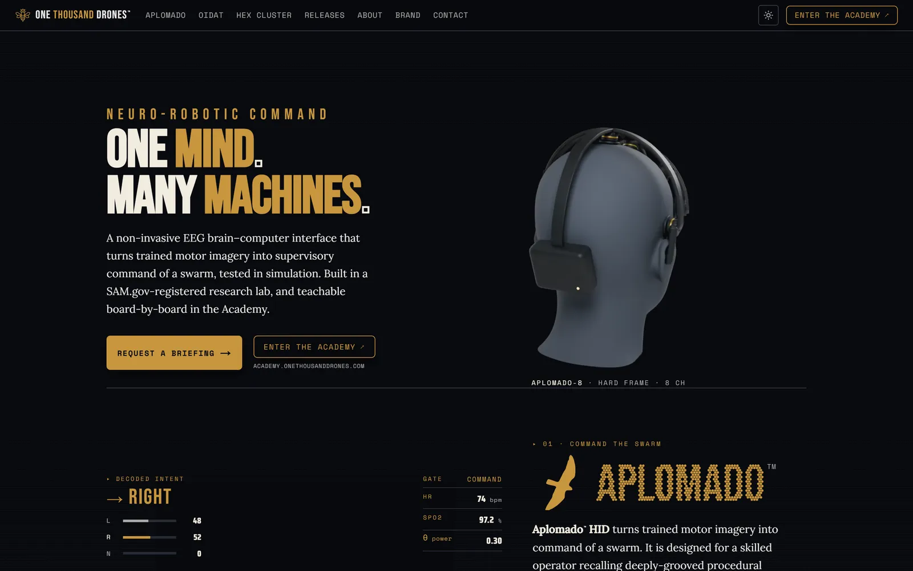</a><br><sub>onethousanddrones.com, captured October 2026.</sub></td>
    <td width="50%"><a href="https://onethousanddrones.com/#aplomado">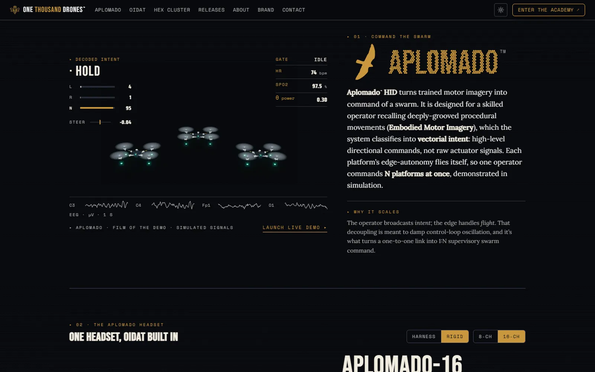</a><br><sub>The Aplomado HID section, simulated signal. onethousanddrones.com, captured October 2026.</sub></td>
  </tr>
</table>

## Academy

An open hardware-engineering curriculum. Twenty-two projects from your first ESP32 board to an EEG BCI, each one a board you draw, lay out and check yourself. L1.01 is free.

**Start** · [academy.onethousanddrones.com](https://academy.onethousanddrones.com) · **Library** · [academy.onethousanddrones.com/library](https://academy.onethousanddrones.com/library)

<table>
  <tr>
    <td width="50%"><a href="https://academy.onethousanddrones.com">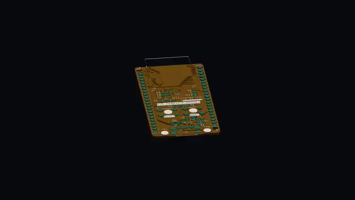</a><br><sub>The L1.01 board's layers, drawn from its own Gerbers.</sub></td>
    <td width="50%"><a href="https://academy.onethousanddrones.com">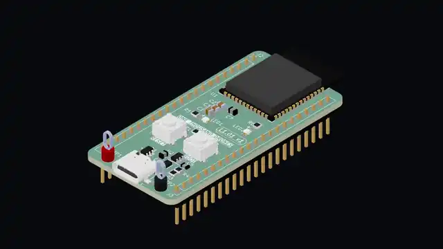</a><br><sub>The L1.01 board, rendered from its released 3D model.</sub></td>
  </tr>
</table>

<table>
  <tr>
    <td width="50%"><a href="https://academy.onethousanddrones.com/projects/l1-01-wroom-breakout/v1/guide">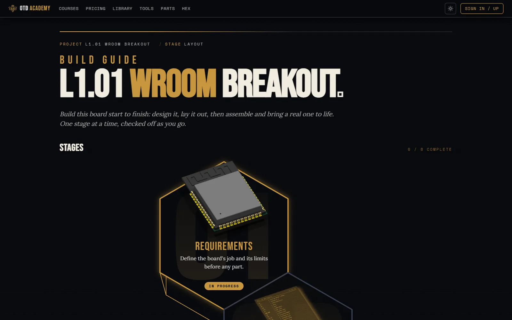</a><br><sub>The L1.01 build guide, captured October 2026.</sub></td>
    <td width="50%"><a href="https://academy.onethousanddrones.com/library">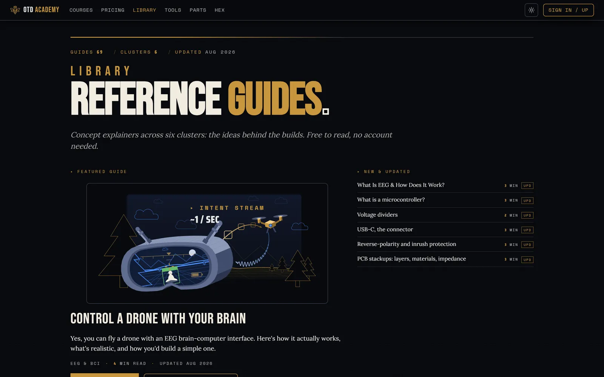</a><br><sub>The free reference library, captured October 2026.</sub></td>
  </tr>
</table>

## Hex Cluster

The printable carrier system our test boards live in. Dovetailed on all six edges, released CC BY 4.0, with a browser configurator that exports only the parts a layout needs.

**Configurator** · [hex.onethousanddrones.com](https://hex.onethousanddrones.com) · **About** · [academy.onethousanddrones.com/hex](https://academy.onethousanddrones.com/hex)

<table>
  <tr>
    <td width="50%"><a href="https://hex.onethousanddrones.com">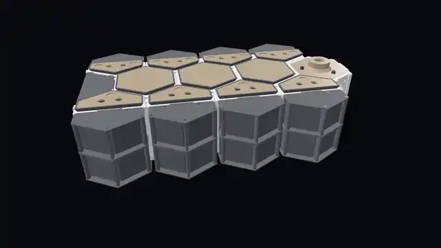</a><br><sub>A GCS mast build assembling, rendered by the configurator itself.</sub></td>
    <td width="50%"><a href="https://onethousanddrones.com/#hex">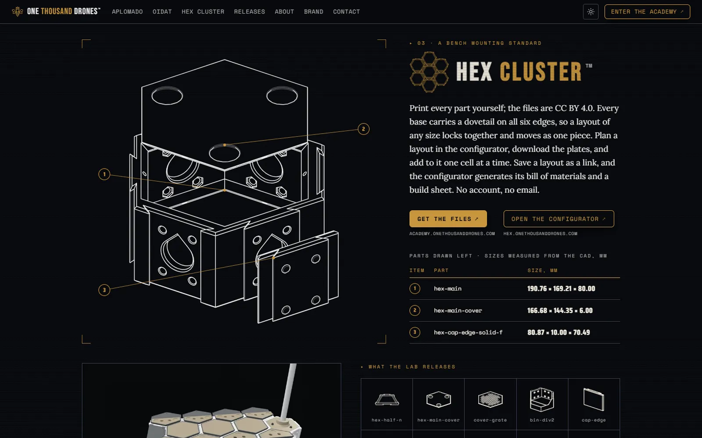</a><br><sub>Parts drawn from the CAD, sizes measured from it. onethousanddrones.com, captured October 2026.</sub></td>
  </tr>
</table>

## Emotive Engine

<p align="center">
  <a href="https://www.npmjs.com/package/@joshtol/emotive-engine"></a>
  <a href="https://www.npmjs.com/package/@joshtol/emotive-engine"></a>
  
</p>

An open-source runtime that turns AI interfaces into expressive characters. You drive it with a natural-language `feel()` call, and it renders emotion as motion.

- 15 emotions and 179 gestures
- 8 elemental shader systems with 160 elemental gestures
- 3D WebGL path with custom GLSL: subsurface scattering, physically based materials, bloom
- Lightweight 2D Canvas path: particles, shape morphing, gaze tracking, mobile-optimized
- Framework-agnostic, working with React, Vue, or vanilla JS

```bash
npm install @joshtol/emotive-engine
```

**Demo** · [emotiveengine.com](https://www.emotiveengine.com) · **Repo** · [emotive-engine](https://github.com/joshtol/emotive-engine)

<table>
  <tr>
    <td width="50%"><a href="https://www.emotiveengine.com">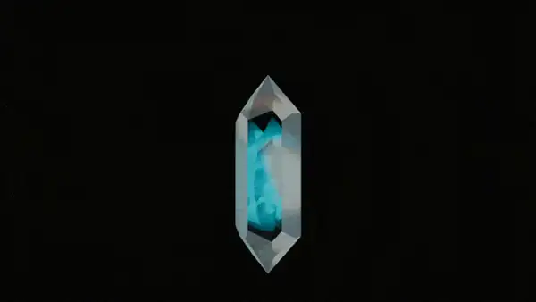</a><br><sub>Elemental gestures, from the engine's own preview set.</sub></td>
    <td width="50%"><a href="https://www.emotiveengine.com/examples">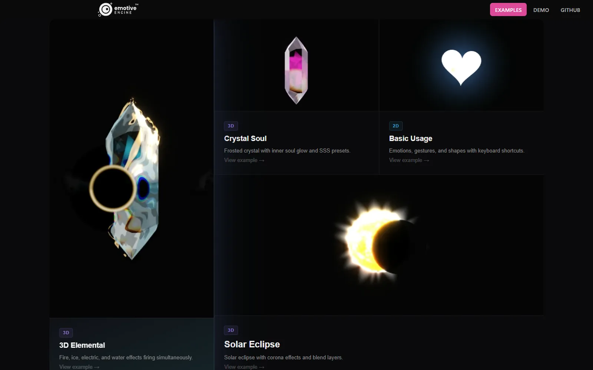</a><br><sub>The examples gallery, emotiveengine.com, captured October 2026.</sub></td>
  </tr>
</table>

---

## Also on the workbench

<table>
  <tr>
    <td width="24%"><a href="https://github.com/Otd-llc/ee-calculators">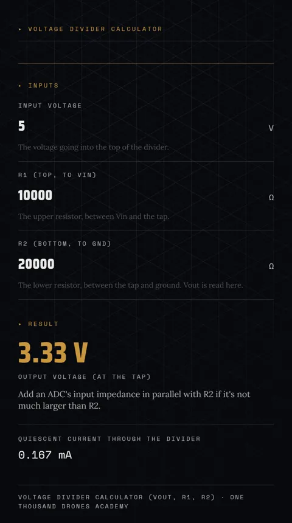</a></td>
    <td valign="top"><b><a href="https://github.com/Otd-llc/ee-calculators">ee-calculators</a></b><br>Tested TypeScript for nine electronics calculators. The MIT-licensed core behind the OTD Academy tools.<br><sub>The voltage divider, from the repo's own docs.</sub></td>
  </tr>
  <tr>
    <td></td>
    <td valign="top"><b><a href="https://github.com/joshtol/caribbean-diving-guide-2025">Caribbean Diving Guide 2025</a></b><br>A full reef-diving guide generated end to end with an agentic AI pipeline.</td>
  </tr>
</table>

---

## Stack

<p>
  
  
  
  
  
  
  
  
</p>

---

## Connect

I'm open to talking about autonomous systems, brain-computer interfaces, and hard interface problems.

<p>
  <a href="https://www.linkedin.com/in/joshuatollette/"></a>
  <a href="https://onethousanddrones.com"></a>
  <a href="mailto:josh@onethousanddrones.com"></a>
</p>

---

<sub><b>ONE THOUSAND DRONES</b> · [onethousanddrones.com](https://onethousanddrones.com) · [academy.onethousanddrones.com](https://academy.onethousanddrones.com) · [github.com/Otd-llc](https://github.com/Otd-llc)</sub>
<!-- otd-readme-kit footer v1 -->
