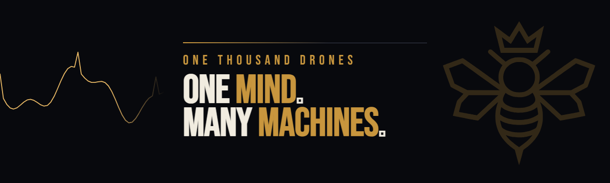
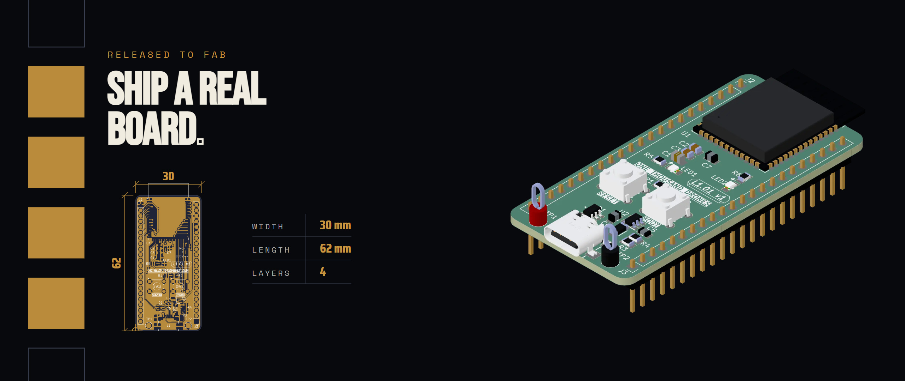

<div align="center">
  
</div>

<h1 align="center">Joshua Tollette</h1>

<p align="center">
  I build autonomous systems and the interfaces that make them usable.
</p>

<p align="center">
  Two projects have most of my attention right now: <b>One Thousand Drones</b>, a defense R&amp;D company building brain-to-swarm control, and <b>Emotive Engine</b>, an open-source animation runtime for expressive AI interfaces.
</p>

---

## One Thousand Drones

My company. A SAM.gov-registered defense research lab building **Brain-to-Swarm**: a non-invasive EEG interface that lets an operator supervise a drone swarm through motor imagery, paired with a safety layer and a training academy.

The public site ships with a live Aplomado HID demo, a technical brief on the three-part system, and a briefing-request flow. Built on Next.js 16, React 19, and TypeScript, deployed on Vercel.

- Site: [onethousanddrones.com](https://onethousanddrones.com)
- Academy: [academy.onethousanddrones.com](https://academy.onethousanddrones.com), an open hardware-engineering curriculum
- Open hardware: [Hex Cluster](https://academy.onethousanddrones.com/hex), the printable carrier system our test boards live in, released CC BY 4.0
- Tooling: [ee-calculators](https://github.com/Otd-llc/ee-calculators), the tested, MIT-licensed math behind the Academy's calculators

<p align="center">
  <a href="https://academy.onethousanddrones.com">
    
  </a>
</p>

<p align="center">
  <sub>The Academy's flagship board. The drawing is generated from the board's own Gerber geometry, the render from its released 3D model.</sub>
</p>

---

## Emotive Engine

<p align="center">
  <a href="https://www.emotiveengine.com">
    
  </a>
</p>

<p align="center">
  <a href="https://www.npmjs.com/package/@joshtol/emotive-engine"></a>
  <a href="https://www.npmjs.com/package/@joshtol/emotive-engine"></a>
  
</p>

An open-source runtime that turns AI interfaces into expressive characters. You drive it with a natural-language `feel()` call, and it renders emotion as motion.

- 15 emotions and 179 gestures
- 8 elemental shader systems with 160 elemental gestures
- 3D WebGL path with custom GLSL: subsurface scattering, physically based materials, bloom
- Lightweight 2D Canvas path: particles, shape morphing, gaze tracking, mobile-optimized
- Framework-agnostic, working with React, Vue, or vanilla JS

```bash
npm install @joshtol/emotive-engine
```

Live demo: [emotiveengine.com](https://www.emotiveengine.com) · Repo: [emotive-engine](https://github.com/joshtol/emotive-engine)

---

## Also on the workbench

| Project | What it is |
|---------|-----------|
| **[Emotive Engine](https://github.com/joshtol/emotive-engine)** | Open-source animation runtime for expressive AI interfaces. Real-time WebGL and Canvas, published on npm. |
| **[ee-calculators](https://github.com/Otd-llc/ee-calculators)** | Tested TypeScript for nine electronics calculators. The MIT-licensed core behind the OTD Academy tools. |
| **[Hex Cluster](https://academy.onethousanddrones.com/hex)** | A printable hex carrier system, dovetailed on all six edges. CC BY 4.0, with a browser configurator that exports only the parts a layout needs. |
| **[Caribbean Diving Guide 2025](https://github.com/joshtol/caribbean-diving-guide-2025)** | A full reef-diving guide generated end to end with an agentic AI pipeline. |

---

## Stack

<p>
  
  
  
  
  
  
  
  
</p>

---

## Connect

I'm open to talking about autonomous systems, brain-computer interfaces, and hard interface problems.

<p>
  <a href="https://www.linkedin.com/in/joshuatollette/"></a>
  <a href="https://onethousanddrones.com"></a>
  <a href="mailto:josh@onethousanddrones.com"></a>
</p>

---

<sub><b>ONE THOUSAND DRONES</b> · [onethousanddrones.com](https://onethousanddrones.com) · [academy.onethousanddrones.com](https://academy.onethousanddrones.com) · [github.com/Otd-llc](https://github.com/Otd-llc)</sub>
<!-- otd-readme-kit footer v1 -->
